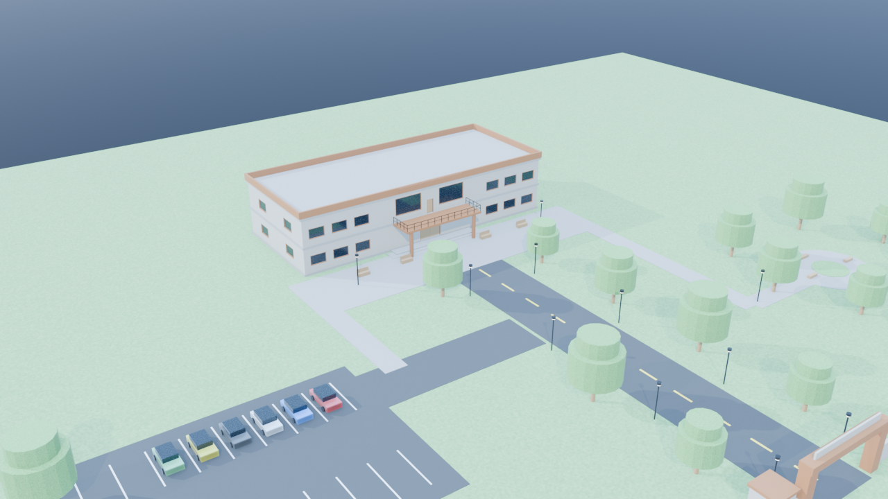

# RCPET IMRD Shirpur - 3D Campus Game in Blender

A procedural, interactive 3D virtual campus game of **R.C. Patel Educational Trust's Institute of Management Research and Development (IMRD), Shirpur**, built natively with Blender Python (`bpy`).



---

## 🎮 Features

- **Procedural 3D Campus Environment (`01_build_campus.py`)**:
  - Full ground terrain with approach road, yellow road divider dashes, parking lot, and pedestrian walkways.
  - Two-floor main academic building with reception counter, ground & first-floor classrooms, student desks, blackboards, central staircase, glass windows, grand entrance canopy with columns, and rooftop parapet.
  - Campus entrance gate with pillars, arch beam, security cabin, and perimeter boundary walls.
  - Outdoor props: Streetlamps with glowing heads, plaza benches, garden circular seating ring with central flowerbed, and 6 colored parked cars.
  - Realistic daylight sun, sky fill lighting, and cinematic cameras.
- **Playable 3D Student Character (`02_player_controller.py`)**:
  - Stylized 3D student avatar (IMRD navy blazer, backpack, head, limbs, shoes).
  - Smooth third-person chase camera.
  - Blender Modal Operator with WASD movement, Shift sprint, Space jump, gravity, elevation detection, and bounding-box collision with walls and obstacles.
- **NPCs & Interactive Objects (`03_npc_interactions.py`)**:
  - **Prof. Sharma (Campus Guide)** stationed at the Main Entrance Plaza.
  - **Aarav** (Student at the Plaza Benches) and **Pooja** (Student at the Garden Seating Circle).
  - Collectible **Golden Student ID Card** hidden near the garden flowerbed.
  - Interactive **Swinging Entrance Door** toggled via proximity interaction.
- **Missions & Progression System (`04_missions.py`)**:
  - Mission 1: *First Day at IMRD* (Meet Prof. Sharma).
  - Mission 2: *Campus Explorer* (Discover all 6 key areas: Plaza, Reception, Classrooms, First Floor, Garden, Parking).
  - Mission 3: *The Lost ID Card* (Find the golden card in the garden and return it to Prof. Sharma).
  - XP rewards, Level progression (Levels 1-10), inventory tracking, achievements, and JSON save/load state.
- **Real-time 2D Viewport HUD (`05_game_ui.py`)**:
  - On-screen active mission banner, player level/XP stats, proximity action prompt (`[E] Talk / Pick up`), and keybinding helper bar.
- **Master Integration & UI Panel (`run_game.py`)**:
  - 3D Viewport Sidebar Panel (N-Panel under `IMRD Game`) with one-click **Start Game** button.

---

## 🚀 How to Run and Play

### 1. Interactive Gameplay in Blender

Open PowerShell and launch Blender with the saved project and master script:

```powershell
& "C:\Program Files\Blender Foundation\Blender 5.2\blender.exe" "output/imrd_campus.blend" --python "scripts/run_game.py"
```

Once Blender opens:
1. In the **3D Viewport**, press **`N`** on your keyboard to reveal the right sidebar.
2. Click on the **`IMRD Game`** tab.
3. Click the **`▶ Start Game (WASD)`** button.
4. Enjoy exploring the campus! Press **`Esc`** or **`Q`** anytime to exit the controller.

### 2. Keyboard & Mouse Controls

| Key | Action |
|---|---|
| **W, A, S, D** or **Arrow Keys** | Walk / Move student character |
| **Mouse Move** | Orbit camera / Look around |
| **Left Shift** | Sprint (1.8x speed) |
| **Spacebar** | Jump |
| **E** | Interact (Talk to Prof. Sharma, pick up ID card, toggle doors) |
| **Esc** or **Q** | Stop controller / Return to Blender editor |

---

## 📁 Project Structure

```
IMRD-Blender-Game/
├── README.md
├── scripts/
│   ├── 01_build_campus.py        # Generates campus architecture, terrain, props, and lighting
│   ├── 02_player_controller.py   # Student avatar, 3rd-person camera, and modal operator
│   ├── 03_npc_interactions.py    # NPCs, collectible ID card, and proximity system
│   ├── 04_missions.py            # Data-driven missions, XP, levels, and progress saves
│   ├── 05_game_ui.py             # 2D Viewport HUD overlay (blf/gpu)
│   └── run_game.py               # Master entry point and Blender UI Sidebar Panel
├── output/
│   ├── imrd_campus.blend         # Master saved 3D Blender project file
│   ├── campus_overview.png       # High-angle isometric render
│   ├── campus_entrance.png       # View from campus gate towards main building
│   ├── player_third_person.png   # Third-person student gameplay perspective
│   ├── npc_guide_entrance.png    # Close-up of Campus Guide at entrance plaza
│   ├── gameplay_overview.png     # Master gameplay render
│   └── game_save.json            # Persistent player save file (XP, level, inventory)
└── tests/
    └── test_all_systems.py       # Automated test suite validating all 5 subsystems
```

---

## 🧪 Running Automated Tests

Run the test suite in headless mode:

```powershell
& "C:\Program Files\Blender Foundation\Blender 5.2\blender.exe" --background --python "tests/test_all_systems.py"
```
